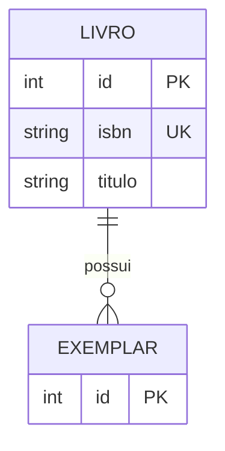

# Modelo da biblioteca

## Entidades e atributos

| Entidade | Atributos | Chave primária | Chaves únicas |
|---|---|---|---|
| LIVRO | | | |
| | | | |

## Relacionamentos

| Relacionamento | Cardinalidade | Justificativa |
|---|---|---|
| | | |

## Diagrama

Notação dos relacionamentos no Mermaid (pé de galinha):

| Símbolo | Significado |
|---|---|
| `\|\|` | exatamente um |
| `o\|` | zero ou um |
| `\|{` | um ou mais |
| `o{` | zero ou mais |

Exemplo: `CURSO ||--o{ ALUNO : tem` se lê "um curso tem zero ou mais alunos; cada aluno
pertence a exatamente um curso".

